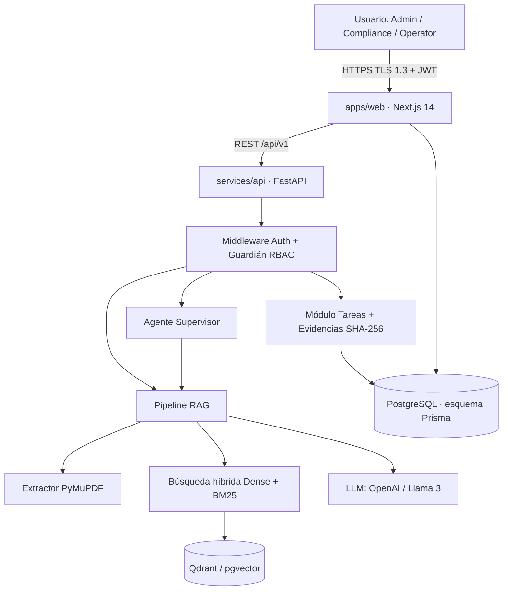

# Arquitectura · Lexi Compliance Platform

## Vista de componentes

## Flujo de una consulta

1. El usuario pregunta en `/asistente`. La web llama `POST /api/v1/query` con su JWT.
2. El RBAC valida el rol y obtiene `tenant_id` del token (nunca del body).
3. `retriever.hybrid_search()` combina similitud coseno (dense) y BM25, siempre filtrando por `tenant_id`.
4. `guard.apply_cutoff()` descarta fragmentos con score < `RAG_COSINE_CUTOFF` (0.75).
5. Sin fragmentos válidos → respuesta fija: *"No se encontró documento de soporte autorizado en la base de conocimiento."*
6. Con fragmentos → el LLM responde solo con ese contexto y devuelve citas `{documento, página, cláusula, score}`.

## Responsabilidad por carpeta

| Carpeta | Dueño | Contenido |
|---|---|---|
| `apps/web/src/app` | Yosvanni | Rutas App Router: `(auth)`, `(dashboard)` |
| `apps/web/prisma` | Yosvanni | Esquema y migraciones (fuente única del modelo) |
| `services/api/app/api` | Yubel / Yosvanni | Routers REST versionados |
| `services/api/app/rag` | Yubel | Parser, chunker, indexador, retriever, guard |
| `services/api/app/agents` | Yubel | Agente Supervisor (vacíos, tareas, evidencias) |
| `services/api/app/core` | Yosvanni | Config, seguridad JWT, RBAC |
| `qa/` | Jonathan | Dataset y casos de prueba |
| `docs/`, `.github/` | Luis | Documentación y proceso |

## Modelo de datos

Tablas: `tenants`, `users`, `documents`, `tasks`, `evidence_files` (ver `apps/web/prisma/schema.prisma`).
Toda tabla de negocio lleva `tenant_id`. La API lee/escribe con SQLAlchemy sobre el mismo esquema (ver ADR-0002).
